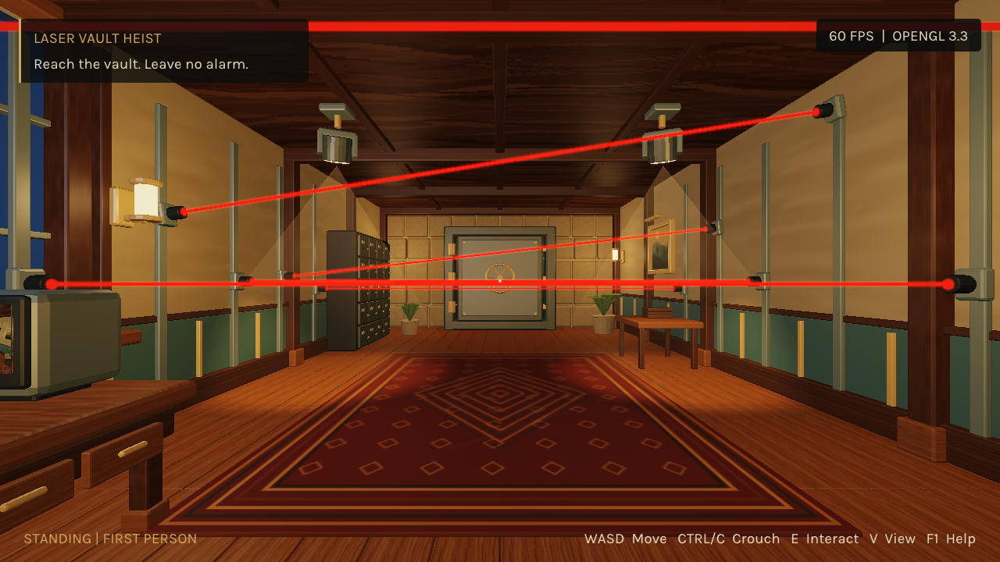

# Laser Vault Heist

A C++17 / OpenGL 3.3 core stealth game for Computer Graphics Fundamentals, topic 12.
Read six moving laser barriers, crouch below the final beam, open the safe and watch
the complete dance finale. Laser contact triggers a red alarm and a fresh attempt.

Students: Nurbek Yerbulekov, Makhmet Demesh, Nurassyl Nygmet  
Group: SE-2428



## Team responsibilities

| Student | Responsibility |
|---|---|
| **Nurbek Yerbulekov — project lead** | Game design, visual direction, models, animation and visual integration |
| Makhmet Demesh | Gameplay mechanics: laser contact, progression and states; rendering and technical integration |
| Nurassyl Nygmet | Gameplay mechanics: controls and interactions; testing, builds and documentation |

Each member should be able to explain the complete project and their assigned area.

## Run

The tested platform is **Windows x64** with an OpenGL 3.3-capable graphics driver.
Extract the complete Windows package and run `LaserVaultHeist.exe`; keep `assets/`
and `shaders/` beside it. No Python, Blender, compiler or network connection is needed.

Source: [Bornqazaq/Final_CGF](https://github.com/Bornqazaq/Final_CGF).
[Release downloads](https://github.com/Bornqazaq/Final_CGF/releases) are versioned;
an older release can predate the latest source. Use the newest release or build
`main` for current gameplay and location changes.

## Build from source

All C/C++ dependencies are vendored. Configuration, build and startup download
nothing. Required: CMake 3.20+ and a C++17 compiler. The exact course starter was not
supplied; the verified local toolchain is LLVM-MinGW 20261020 / Clang 23.1.4,
CMake 3.31.6 and Ninja 1.11.1 on Windows.

With Clang and Ninja on PATH:

```powershell
cmake -S . -B build -G Ninja -DCMAKE_BUILD_TYPE=Release -DCMAKE_C_COMPILER=clang -DCMAKE_CXX_COMPILER=clang++
cmake --build build --parallel
ctest --test-dir build --output-on-failure
.\build\LaserVaultHeist.exe
```

Visual Studio 2022 C++ desktop tools are an alternative build configuration:

```powershell
cmake -S . -B build-msvc -G "Visual Studio 17 2022" -A x64
cmake --build build-msvc --config Release --parallel
ctest --test-dir build-msvc -C Release --output-on-failure
.\build-msvc\Release\LaserVaultHeist.exe
```

MSVC, Linux and macOS have not been executed here. On Linux/macOS use the normal
CMake configure/build workflow; Linux also needs GLFW's native window-system
development packages, and macOS needs Xcode command-line tools. The context requests
core/forward compatibility on macOS. The GPU regression test needs a working graphics
context. Never reuse a build directory across compilers.

## Controls and settings

| Input | Action |
|---|---|
| Enter / Begin | Start |
| WASD / mouse | Move / look |
| V | First- or third-person camera |
| Hold Ctrl or C | Crouch |
| E | Use the targeted object within 2.15 m |
| Esc / F1 | Pause / controls help |
| R | Retry after alarm or victory |
| F12 | Save a runtime screenshot |

In first person the body follows the mouse. In third person mouse movement orbits
the camera independently; standing movement turns the character toward actual
displacement and uses forward walking for A/D/S as well. Crouching uses the supplied
directional clips. The camera contracts before obstacles and the locked entrance gate.

Menu and pause include mouse sensitivity and FPS settings. Sensitivity uses a
Source-style multiplier: `0.022 × sensitivity` degrees per mouse count. Auto FPS
follows the active monitor's refresh rate; presets include connected-monitor modes,
Custom accepts 1–10000 FPS, and Unlimited disables pacing. Retry preserves these
preferences. Windows uses fresh `WM_INPUT` motion consumed once per frame.

## Implemented features

- Custom indexed OpenGL pipeline and separate GLSL 330 vertex/fragment programs.
- Shared laser matrices for rendering and inverse-transform point-versus-box contact;
  normalized movement and fixed 240 Hz simulation with retained one-shot inputs.
- Blinn–Phong per-fragment shading, eight point lights, two rotating spotlights,
  ambient/moon terms, attenuation, soft spot edges and one PCF shadow map.
- UV-mapped textures, generated mipmaps, static instancing and hierarchical safe
  wheel/bolt/door animation.
- Live CCTV through an actual second-camera framebuffer; lamp toggle and CCTV switch.
- A 15 m vault, decorated enclosed entrance corridor, locked gate and matching collision.
  Paintings and deposit furniture are separated from the security mounting rails.
- Current Meshy-exported thief: 30,725 triangles, 52 weighted bones plus ancestors,
  four normalized influences per vertex and twelve runtime animation clips.
- Forward crouching derived from the supplied backward cycle; contact-corrected leg
  poses, directional crouching and distance-driven GPU skinning.
- Safe opening over 3.4 s, then a complete 7.5 s dance before Victory. The full door
  sweep is at least 1.70 m clear of the last beam.
- HDR display conversion and compact depth-aware laser glow. The GPU regression
  verifies that a rear beam does not bleed over the character silhouette.

## Current report and evidence

The refreshed [report](deliverables/report/Laser_Vault_Heist_Report.pdf) follows the
course sections, includes all three students, eighteen journal references, current
screenshots and a new hardware/FPS table. Source articles and ranking provenance
are retained in `docs/references-verified.json` and `evidence/source-audit.json`.

Seven CTest suites pass: gameplay mathematics, complete route, demo/slow-frame
behavior, imported animation, complete finale, camera/input/settings and real GPU
laser occlusion. `evidence/screenshots/report-current/` contains new framebuffer
captures. New uncapped benchmark CSVs and memory measurements are in
`evidence/benchmarks-current/`; the old `evidence/benchmarks/` results are historical.

Three current visible 1280×720 runs lasted 25 s each, excluding 5 s warm-up:

| Run | Average FPS | 1% low FPS | Peak working set |
|---|---:|---:|---:|
| 1 | 1148.9 | 695.8 | 140.9 MiB |
| 2 | 1185.3 | 726.5 | 144.9 MiB |
| 3 | 1168.2 | 660.3 | 140.9 MiB |

Hardware: Intel Core i5-13400F, RTX 5060, approximately 32 GiB RAM, Windows x64;
OpenGL 3.3.0 NVIDIA 617.42. VSync, frame cap and recording were disabled. Measurements
cover the whole frame loop, including rendering submission, simulation, UI, telemetry
and presentation. These are local results, not isolated GPU timings or a guarantee
for the unknown TA machine. The user has confirmed the corrected mouse behavior
and reviewed the refreshed location; this is not a formal usability study.

Fresh report screenshots also come from a newly captured 1080p run using ordinary
deterministic inputs and collision, captions and a visible FPS counter. The final
route in that recording is continuous.
Earlier slide materials remain a separate historical deliverable until refreshed.

## Requirement map

| Requirement | Evidence |
|---|---|
| R1: modern pipeline | `graphics.cpp`, `renderer.cpp`, separate shaders, runtime diagnostics |
| R2: 5+ objects | Current vault, corridor, furniture, fixtures, safe and character assets |
| R3: MVP / hierarchy | `scene.cpp`, `world.cpp`, `surface.vert`; safe and spotlight pivots |
| R4: dynamic per-fragment light | `surface.frag`; lamp, moving spots and red alarm |
| R5: texture sampling | UV exports, PNG textures, mipmaps in `graphics.cpp` |
| R6: controls / interactions | Native mouse input, two cameras, lamp/CCTV/safe actions |
| R7: real time / counter | Current raw measurements, hardware table and on-screen FPS |
| R8: build / documentation | Vendored CMake project and commands above |

All three topic stretch goals are implemented: rotating equipment/light cones, live
CCTV and safe-opening victory. Exact course-starter compatibility, TA hardware,
every member's live understanding and account history, rehearsal and submission
remain external assessment items. See `docs/requirements-evidence.md` for the full map.

## Project layout and reproduction

`src/`, `include/` and `shaders/` contain the runtime. `assets/` contains native scene,
mesh, texture and animation data; `assets/exchange/` holds GLB exchange copies.
`art/blender/` contains editable sources, and `art/source/animated_thief/` preserves
the supplied FBX/textures. Python scripts under `tools/` prepare assets, capture
evidence, measure performance and build documents; they are not runtime dependencies.

Useful inspection flags: `--entrance-preview`, `--character-preview --clip CrouchWalk`,
`--finale-preview`, `--demo`, `--auto-route --seconds 25`, `--fps auto`, `--fps 0`,
`--1080p`, and `--root PATH`. Hidden/demo/auto-route QA runs are uncapped unless an
explicit FPS option is supplied. Ordinary play defaults to monitor refresh.

Third-party asset provenance and dependency licenses are in `CREDITS.md` and
`LICENSES/`. Meshy-exported resources are credited separately from project-created
room assets and derived animation. Public repository visibility does not grant an
additional license for project-specific source or art.

The current PDF builder is `tools/documents/build_report_pdf.py`. It uses reportlab,
pypdf, Pillow and Windows Times fonts; it reads the current evidence folders. The
retained local course template supplies its original logo when available. Document
authoring dependencies are separate from the game build.
