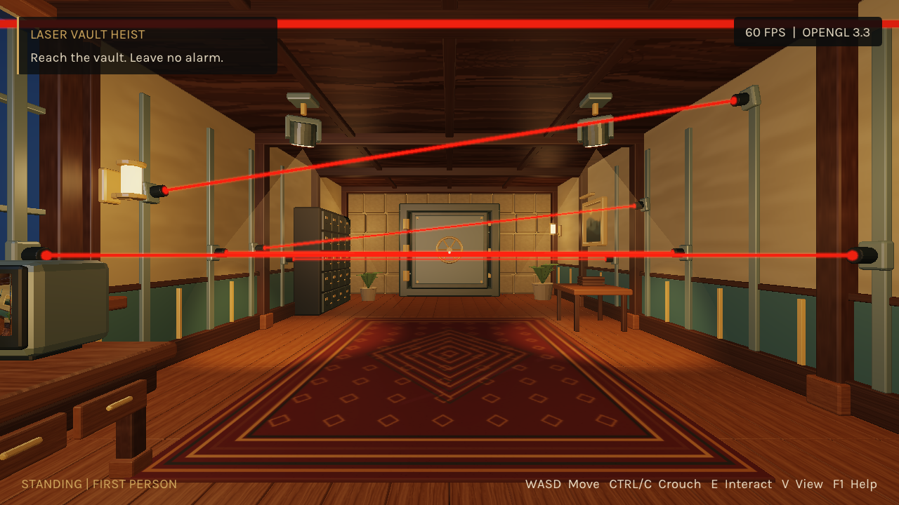

# Laser Vault Heist

A real-time 3D stealth game built with **C++17 and OpenGL 3.3 Core**.
Cross six moving laser barriers, crouch through the final gap and open the vault.
Contact with a beam triggers an alarm; reaching the safe unlocks its mechanical
opening sequence and the character's victory dance.

Computer Graphics Fundamentals — final project, Topic 12<br>
Students: Nurbek Yerbulekov, Makhmet Demesh, Nurassyl Nygmet<br>
Group: SE-2428



## Features

- First- and third-person cameras, independent third-person orbit and obstacle avoidance.
- Moving and rotating laser barriers with oriented collision volumes.
- Standing and directional crouching animations with GPU skinning and twelve clips.
- Interactive desk lamp, a live CCTV feed (in-room monitor and full-screen view) and an articulated safe.
- Blinn-Phong lighting, moving spotlights, a shadow map, HDR tone mapping and
  depth-aware laser glow.
- A furnished vault and enclosed entrance corridor with a visible locked security gate.
- A complete failure/retry loop and a 10.9-second safe-opening and dance finale.
- Mouse sensitivity, monitor-aware FPS limits, custom limits and an on-screen FPS counter.

## Play

Tested on Windows x64 with an OpenGL 3.3-capable GPU driver.
Follow [Build and test](#build-and-test) to build and run the game from the current source.

| Input | Action |
|---|---|
| Enter | Begin |
| WASD | Move |
| Mouse | Look / orbit |
| V | Switch first- and third-person view |
| Hold Ctrl or C | Crouch |
| E | Use the lamp, CCTV or safe |
| Esc | Pause and settings |
| F1 | Controls help |
| R | Retry after alarm or victory |
| F12 | Save a screenshot |

In first person, mouse movement also turns the character. In third person, it
orbits the camera; standing movement turns the character toward travel. The safe
becomes usable after the final laser has been crossed.

In the settings you can change mouse sensitivity and the FPS limit (Auto follows
the monitor's refresh rate, Custom accepts 1–10000 FPS, Unlimited disables the
limiter). Camera mode and settings persist across retries.

## Build and test

Requires CMake 3.20+, Ninja and a C++17 compiler. All libraries are included in
`third_party/`, so nothing is downloaded during the build. We built and tested with
LLVM-MinGW (Clang 23.1.4), CMake 3.31.6 and Ninja 1.11.1.
With Clang and Ninja on `PATH`, run from the repository root:

```powershell
cmake -S . -B build -G Ninja -DCMAKE_BUILD_TYPE=Release -DCMAKE_C_COMPILER=clang -DCMAKE_CXX_COMPILER=clang++
cmake --build build --parallel
ctest --test-dir build --output-on-failure
.\build\LaserVaultHeist.exe
```

To assemble a portable folder:

```powershell
cmake --install build --prefix dist/Windows-x64
```

Seven test suites cover collision and gameplay, the complete route, slow frames,
animation data, the finale, camera/input/settings, and laser occlusion through the
actual OpenGL renderer. The rendering test requires a working graphics context.

## Performance

Three uncapped 1280 × 720 runs on an Intel Core i5-13400F and NVIDIA GeForce RTX 5060,
with approximately 32 GiB RAM and Windows x64. Each run lasted 25 seconds, with the
first five seconds excluded. VSync and recording were disabled.

| Run | Average FPS | 1% low FPS | Peak working set |
|---|---:|---:|---:|
| 1 | 1148.9 | 695.8 | 140.9 MiB |
| 2 | 1185.3 | 726.5 | 144.9 MiB |
| 3 | 1168.2 | 660.3 | 140.9 MiB |

These measurements cover the complete frame loop. Raw timings and methodology
are in [`evidence/benchmarks-current/`](evidence/benchmarks-current/).

## Known limitations

- Laser collision is discrete (fixed body points at 240 Hz), not swept.
- Linear blend skinning: knees thin out slightly in a deep crouch.
- One directional shadow map; spotlights do not cast shadows.
- Only Windows has been tested; Linux and macOS builds have not been validated.

## Team

| Student | Contribution |
|---|---|
| Nurbek Yerbulekov | Project lead; game design, visual direction, character and environment asset work, animation and visual integration |
| Makhmet Demesh | Gameplay mechanics: laser collision, progression and game states; rendering and technical integration |
| Nurassyl Nygmet | Gameplay mechanics: controls and interactions; tests, builds and documentation |

## Project files

| Folder | Contents |
|---|---|
| `src/`, `include/` | C++ application, gameplay, cameras, resource loading and rendering |
| `shaders/` | Separate GLSL vertex and fragment programs |
| `assets/` | Runtime geometry, textures, scene manifests and animation data |
| `art/` | Editable Blender assets and original character source files |
| `tests/` | C++ regression tests |
| `third_party/`, `LICENSES/` | Runtime dependencies and license notices |
| `docs/` | Architecture, asset formats, camera behavior and requirement mapping |
| `evidence/` | Runtime screenshots, test results and performance measurements |

The [project report](deliverables/report/Laser_Vault_Heist_Report.pdf) covers the
implementation, literature review, screenshots and evaluation. See
[architecture](docs/architecture.md), [asset formats](docs/runtime-formats.md) and
[requirement coverage](docs/requirements-evidence.md) for source-level details.
Asset origins and third-party licenses are listed in [CREDITS.md](CREDITS.md).

## Contribution & AI Usage

Nurbek Yerbulekov — game design, character, and animation. Nurbek used AI to explore gameplay ideas and Meshy to generate the thief model. He selected the design, exported the model as FBX, and prepared animation clips in Mixamo. Codex helped integrate the assets and derive the missing forward crouch animation from the supplied clips. Nurbek playtested the game, reported visual and control issues, and confirmed that the mouse input fix worked.

Makhmet Demesh — laser gameplay and rendering. In this area of the project, Codex assisted with the collision check that compares player sample points against each laser beam in its local coordinates. It also helped correct the rendering so that laser glow respects scene depth and does not show through the character.

Nurassyl Nygmet — controls, cameras, and interactions. In this area of the project, Codex assisted with processing Windows mouse movement, separating third-person camera orbit from character rotation, and adjusting camera distance near walls so the camera could avoid obstacles without changing the player’s viewing direction.


